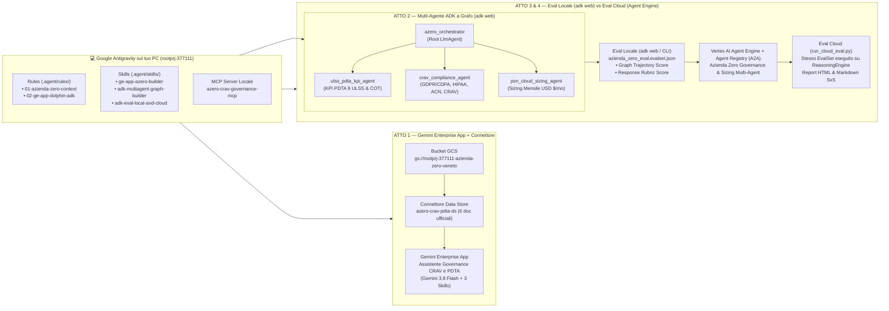

# Azienda Zero (Regione del Veneto) — End-to-End Demo: Gemini Enterprise App + Antigravity + ADK Multi-Agent Graph & Eval (`rootprj-377111`)

Repository completo per la demo live con **Google Antigravity** collegato al progetto GCP **`rootprj-377111`** per **Azienda Zero (Regione del Veneto)** — *Governance Sanitaria Regionale: Gare CRAV Telemedicina/FSE PNRR, Monitoraggio PDTA 9 ULSS, Compliance Privacy GDPR/CDPA/ACN e Sizing Infrastrutturale Cloud/PSN*.

---

## 🏗️ Architettura della Demo in 4 Atti (da Antigravity sul tuo PC)



---

## 📂 Struttura del Repository

```text
azienda-zero-ge-adk-demo/
├── GEMINI.md                                      # Istruzioni principali per Antigravity sul tuo PC
├── AGENTS.md                                      # Regole agentiche e puntatori alle 3 Skills
├── PLAYBOOK_DEMO_ANTIGRAVITY_AZIENDA_ZERO.md      # Copione passo-passo con i prompt da incollare in Antigravity
├── .agent/
│   ├── mcp_config.json                            # Configurazione Server MCP locale per Antigravity
│   ├── rules/
│   │   ├── 01-azienda-zero-context.md             # Contesto Azienda Zero Veneto + Regola Tassativa Pricing USD/mo
│   │   └── 02-ge-app-dolphin-adk.md               # Best practice Dolphin ADK per Gemini Enterprise App
│   ├── skills/
│   │   ├── ge-app-azero-builder/SKILL.md          # Skill Atto 1: Connettore GCS + Agente GE App + 3 Skills
│   │   ├── adk-multiagent-graph-builder/SKILL.md  # Skill Atto 2 & 4: Multi-Agente ADK, Graph Topology & Deploy
│   │   └── adk-eval-local-and-cloud/SKILL.md      # Skill Atto 3 & 4: Eval Locale (adk web) vs Eval Cloud
│   └── workflows/
│       ├── 1-ge-app-connector.md                  # Slash workflow /1-ge-app-connector
│       ├── 2-adk-graph-local.md                   # Slash workflow /2-adk-graph-local
│       ├── 3-adk-eval-local.md                    # Slash workflow /3-adk-eval-local
│       └── 4-deploy-and-cloud-eval.md             # Slash workflow /4-deploy-and-cloud-eval
├── .gemini/
│   └── settings.json                              # Configurazione MCP compatibile Gemini CLI / Antigravity
├── mcp_servers/
│   └── azero_crav_mcp_server.py                   # Server MCP stdio zero-dependency per Antigravity
├── setup_azero_ge_connector.py                    # Atto 1: Crea Bucket GCS, carica 6 doc e indicizza Connettore in 2s
├── register_azero_ge_agent.py                     # Atto 1: Pubblica Chat Agent Multi-Livello (Gemini 3.8 Flash) e 3 Skills
├── azienda_zero_agent/                            # Atto 2: Package Multi-Agente ADK a Grafo (4 nodi + 7 tool)
│   ├── __init__.py
│   ├── agent.py                                   # Grafo: azero_orchestrator -> 3 sub-agenti specialistici
│   ├── tools.py                                   # FunctionTool ADK (KPI 9 ULSS, Compliance ACN/GDPR, Sizing USD)
│   ├── callbacks.py                               # 6 Callback OpenTelemetry & tracciamento nodi del grafo
│   ├── requirements.txt
│   ├── azienda_zero_eval.evalset.json             # Atto 3: EvalSet nativo per tab Eval di `adk web` e script Cloud
│   └── test_config.json                           # Soglie di validazione (tool_trajectory_avg_score >= 0.80)
├── run_local_adk_web.sh                           # Atto 2: Avvia `adk web --port 8080` per mostrare Graph & Eval
├── run_local_eval.py                              # Atto 3: Esegue l'Eval in locale sul grafo e genera report HTML/MD
├── deploy_azero_adk.py                            # Atto 4: Deploy su Vertex AI Agent Engine + Agent Registry (A2A)
├── test_remote_azero_agent.py                     # Atto 4: Interroga in streaming il Multi-Agente deployato in Cloud
├── run_cloud_eval.py                              # Atto 4: Ripete l'Eval in Cloud sul ReasoningEngine e confronta Local vs Cloud
├── documenti_azero/                               # I 6 documenti HTML ufficiali indicizzati nel Connettore GE App
└── artifacts/
    ├── GE_APP_AGENT_INSTRUCTIONS_AZERO.md         # Specifiche Dolphin ADK pronte per il Visual Builder GE App
    ├── EVAL_COMPARISON_LOCAL_VS_CLOUD.md          # Report Markdown comparativo Eval Locale vs Eval Cloud
    └── eval_report_comparison.html                # Dashboard HTML interattiva Eval Locale vs Eval Cloud
```

---

## 🚀 Quickstart sul tuo PC con Antigravity

1. **Clona il repository sul tuo PC e aprilo in Antigravity**:
   ```bash
   git clone https://github.com/marangonic/azienda-zero-ge-adk-demo.git
   cd azienda-zero-ge-adk-demo
   ```
2. **Assicurati di essere autenticato con `gcloud` sul progetto `rootprj-377111`**:
   ```bash
   gcloud config set project rootprj-377111
   gcloud auth application-default login
   ```
3. **Pre-riscalda tutto l'ambiente prima della call (opzionale, 1 comando per avere già Connettore, Agente GE App e Agente ADK Cloud pronti)**:
   ```bash
   python3 setup_azero_ge_connector.py && python3 register_azero_ge_agent.py
   ```
4. **Segui il copione live in [`PLAYBOOK_DEMO_ANTIGRAVITY_AZIENDA_ZERO.md`](./PLAYBOOK_DEMO_ANTIGRAVITY_AZIENDA_ZERO.md)**!
